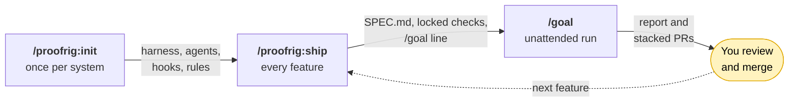
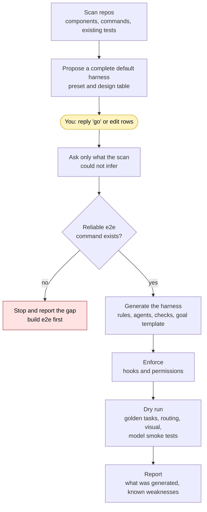
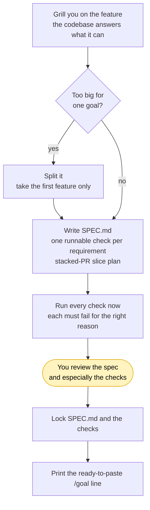
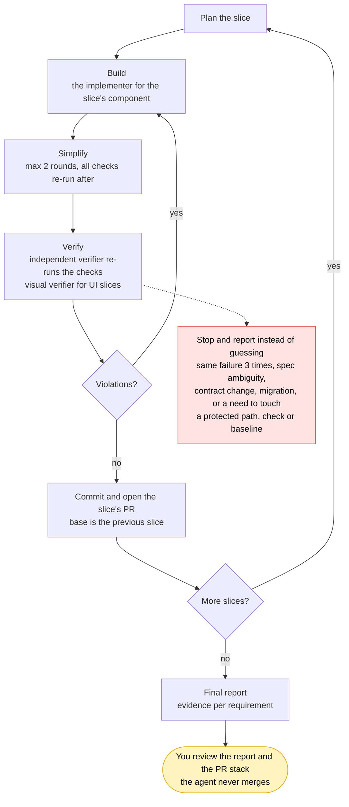

# proofrig

**Harness engineering for Claude Code.** Build a verification harness once per system, then ship features through it reliably with a single `/goal`.

> **Proof**: done means evidence, not assertion. **Rig**: the harness around the model.

```bash
claude plugin marketplace add tancejang/proofrig
claude plugin install proofrig@proofrig
```

## Why

`/goal` keeps Claude working until a condition is met. A vague condition gets a vague result. What makes unattended runs reliable is the harness around the model:

- **Checkable done-criteria** written before the work starts, so "done" is a command that passes.
- **Independent verification** by an agent that did not write the code and re-runs the checks itself.
- **Enforcement by hooks and permissions**, not by asking the model to be careful.
- **Bounded loops** with a stop-and-report rule instead of improvising around a failing check.
- **Small, reviewable output**: a stack of PRs, not one giant diff.

proofrig builds that harness for your system, and prepares each feature so one pasted `/goal` can run on its own.

## Two commands

| Command | When | What it does |
|---|---|---|
| `/proofrig:init` | Once per system (re-run in update mode when it changes) | Scans your repos, proposes a complete default harness, asks only about what you want to change or it could not infer, generates it, and after one reply from you ("go") proves it with a dry run, all in the same session with no restart |
| `/proofrig:ship` | Every feature | Grills you on the feature, writes `SPEC.md` with a runnable check per requirement and a stacked-PR slice plan, confirms each check fails before the work exists, and prints a ready-to-paste `/goal` line |

## Quick start

1. **Install** (above), then open Claude Code at your system's root (the folder containing your repos).
2. **Run `/proofrig:init`.** Review the proposed design table and reply "go", or edit the rows you disagree with. Answer the few questions it could not infer from the scan.
3. **Run `/proofrig:ship`** and describe a feature. Answer the grilling. Review the spec and, above all, the checks. This is the one human gate.
4. **Paste the `/goal` line** it prints, and walk away.
5. **Come back to a report and a stack of PRs.** Review them. The agent opens PRs but never merges them.

The line from step 4 looks like this (a trimmed, made-up example; the real one is filled from your `harness/goal-template.md` and also lists your commands, branches, and size limits). Paste it after `/goal `:

```text
Implement csv-export per specs/csv-export/SPEC.md. Follow harness/CLAUDE.md.
Work as a stack of 3 slices (see SPEC.md "Slices"): plan, build with the slice's implementer, simplify, verify.
Done when ALL are true, with command output shown as evidence:
- Every check in specs/csv-export/checks/ passes, including after the simplify pass.
- npm run e2e exits 0.
- The verifier reports no unaddressed spec or rule violations for every slice.
- Each slice has its own PR based on the previous slice; none is merged.
Stop and report (do not guess) when: same failure 3 times, spec ambiguity, a contract change not in the spec, or any need to modify a protected path or existing check.
```

## How a feature moves



Yellow steps are the human gates. Everything else runs on its own. Detail for each stage:

### 1. `/proofrig:init`: build the harness (once)



### 2. `/proofrig:ship`: turn a feature into checkable work (every feature)



### 3. `/goal`: the unattended run (one slice at a time)



Red marks where a run halts: it reports what it found rather than working around a failing check.

## What `/proofrig:init` generates

```
CLAUDE.md                        system map: repos, contracts, commands, non-goals
.claude/
  settings.json                  permissions, hooks, router env
  hooks/                         hook scripts (PreToolUse, Stop)
  agents/                        planner, implementer-<component>, simplifier,
                                 verifier (read-only), verifier-visual (if UI)
harness/
  harness.config.md              the design you accepted, with rationale
  components.md                  component registry: paths, commands, check kinds, models
  rules/                         base, per-role, per-component, and project rules (with IDs)
  models.md                      model per role, router settings, fallbacks
  goal-template.md               the /goal skeleton with your real commands
  report-template.md  failure-log.md  e2e/  visual/  golden-tasks/
<each repo>/CLAUDE.md            short: commands, conventions, gotchas
```

## Design principles

- **Defaults first.** Every decision comes with a recommended default derived from the scan. Accept everything with one reply, or change only what you care about.
- **The e2e gate.** If a reliable command to bring up the system and verify across repos does not exist, `init` stops and reports the gap rather than scaffolding a harness that verifies nothing.
- **Enforce, don't ask.** Anything that must never happen (editing locked checks, touching protected paths, leaving a component's boundaries) goes into hooks and permissions, not prose.
- **Independent verification.** The verifier is read-only, starts with fresh context, assumes the work is wrong, and re-runs the checks itself.
- **Checks before code.** Each requirement gets a runnable check that must fail before the feature exists. Checks are frozen during the run so the agent cannot edit its way to green.
- **Stacked PRs.** Work lands as small slices (target about 400 changed lines), each green on its own, contracts first, so a human can actually review them.

## Presets

`init` picks a starting point from the scan and explains why. You edit from there.

| | Lean | Standard (default) | Strict |
|---|---|---|---|
| Pipeline | plan, build, verify | plus spec, simplify, fix loop, stacked PRs, report | plus red-team pass and security review |
| Autonomy | hands-off | balanced | pause after each slice |
| Verifier | one | one, plus visual if UI | different model family than the implementer |
| Delivery | single PR | stacked, about 400 lines per slice | stacked, about 250 lines per slice |

## Components and checks

The scan classifies each part of your system, and `init` creates one implementer per component with its own rules and path-scoped edits. `ship` chooses check kinds per requirement:

| Component | Default check kinds |
|---|---|
| Backend API | unit, integration, contract tests, schema diff |
| Web frontend | component tests, browser e2e, screenshot checks, accessibility |
| Mobile | emulator flows, screenshot checks |
| Data / migrations | dry run on seeded DB, rollback test |
| Infra | plan or diff review only, never apply |
| Worker / job | integration with seeded queue, idempotency |
| Shared library | unit tests plus consumer compile or contract checks |

**Screenshot checks** run as a baseline diff against an approved image, or as a rubric review for new UI. The verifier captures its own screenshots, baselines are locked during runs, new baselines go to the report for your approval, and rendering must be deterministic (seeded data, fixed viewport, animations off, fonts pinned, clocks mocked).

## Models

Each agent file carries its own `model:` line, so you can run, for example, a strong model for planning and verifying and a faster one for implementing. Models served through a router or gateway use the router's exact model ID. `init` records a fallback model per role and smoke-tests every role during the dry run.

## Requirements

- Claude Code with plugin support and `/goal`.
- `git`, and a PR tool (`gh` or Graphite; configurable during `init`).
- Optional: a headless browser tool such as Playwright for visual checks, and the `grill-me` skill for the feature interview (`ship` falls back to its own interview without it).

## Status and limitations

proofrig is **v0.1.x** (see [CHANGELOG](plugins/proofrig/CHANGELOG.md)). It installs, both skills load, and the e2e suite runs `/proofrig:init` on small fixtures, but it has not yet been exercised on a real multi-repo system, so expect to tune it.

- Hooks (stop checks, protected paths, component path scoping, `.locked` freezing) are specified by the skills; `init` registers them in your `.claude/settings.json` and writes the hook scripts to `.claude/hooks/`. They are not shipped as code in the plugin (the hooks under `.claude/hooks/` are this repo's own harness), so the dry run is what proves they work in your Claude Code version.
- A subagent's `model:` string reaching a router unchanged is assumed, not guaranteed. The per-role smoke test checks it.
- Visual checks are only as good as their determinism. A flaky check is treated as a bug, not retried until green.
- Humans still review the spec, the checks, and every PR. proofrig reduces what you have to catch, not what you are responsible for.

## Improving your harness

Every bad or surprising run should end in a harness change. Append it to `harness/failure-log.md` with the new rule or mechanical check that would have caught it. Re-run `/proofrig:init` (update mode) when repos, commands or components change; it reads `harness/harness.config.md` instead of re-asking, and re-run the golden tasks after any harness change.

## Repo layout

```
.claude-plugin/marketplace.json
.claude/            settings.json, agents/, hooks/{guard,stop}.mjs (this repo's own harness, not shipped)
CLAUDE.md           repo map and commands for agents working on proofrig
LICENSE
e2e/                run.mjs, approve.mjs, fixtures/ (plugin's own test suite, not shipped)
harness/            rules, goal template, golden tasks for developing proofrig (not shipped)
plugins/proofrig/
  .claude-plugin/plugin.json
  CHANGELOG.md
  skills/
    init/   SKILL.md, references/{base-rules.md, templates.md}
    ship/   SKILL.md
specs/              feature specs and locked checks written by /proofrig:ship
```

Skills are namespaced by the plugin name, hence `/proofrig:init` and `/proofrig:ship`. After editing, run `claude plugin validate .` (marketplace) and `claude plugin validate plugins/proofrig` (plugin.json and skills).

## Developing proofrig

This repo dogfoods proofrig: it has its own harness (`CLAUDE.md`, `harness/`, `.claude/`). Read `harness/CLAUDE.md` first for the roles, hooks, limits, and known weaknesses. Changes go through the same flow as any system: `/proofrig:ship` writes `specs/<feature>/SPEC.md` and its checks, then you paste the printed `/goal` line. During a run, each implementer may edit only its component's paths (`harness/components.md`).

Checks to run after any change:

```bash
claude plugin validate .                    # marketplace manifest and its plugin entry
claude plugin validate plugins/proofrig     # plugin.json and skill frontmatter
node harness/golden-tasks/hooks.test.mjs    # golden tests for .claude/hooks/guard.mjs and stop.mjs
```

The Stop hook also runs `claude plugin validate --strict .`, `claude plugin validate --strict plugins/proofrig`, and `node --check` on the scripts in `e2e/`, `.claude/hooks/`, and `harness/golden-tasks/` before every turn ends.

`harness/`, `.claude/`, and `e2e/` are protected from subagents by `.claude/hooks/guard.mjs`: only the main session and the harness component's implementer may edit them, with no restart or unlock step (earlier versions needed a session started with `PROOFRIG_UNLOCK=1`; this repo no longer reads it). The verifier's REV-9 flags any change to `e2e/`, `.claude/`, or `harness/golden-tasks/` that the spec doesn't name. Nothing edits `.git/` or a locked spec.

## E2E

`node e2e/run.mjs [with-e2e|no-e2e]` (exit 0 = pass). Runs `/proofrig:init` for real (via `claude -p`, loading the plugin from this checkout with `--plugin-dir`) against throwaway copies of `e2e/fixtures/`, then feeds sample tool calls to the generated hooks: protected paths, `.locked` specs, force-push, and the Stop hook on red/green tests. `no-e2e` asserts init stops at the gap report. Workspaces and logs are left in the temp dir for inspection.

Prerequisites:

- `claude` on your PATH and logged in. The run makes live model calls. It passes `--setting-sources project`, so router environment variables must be set in your shell, not in your user `settings.json`.
- `PROOFRIG_E2E_MODEL` (optional): passed as `--model`. With a router, use the router's exact model ID. If unset, the CLI default model is used.
- `git` and Node. Stdlib only, nothing to install.
- Windows: Git Bash. Hooks are run through bash, the way Claude Code runs them. The default is `C:/Program Files/Git/bin/bash.exe`; set `PROOFRIG_BASH` to another `bash.exe` if Git is installed elsewhere (not `System32\bash.exe`, which is WSL). On other platforms `bash` from PATH is used, and `PROOFRIG_BASH` overrides it there too.

Duration: each case is one live init run with a 10-minute timeout and no retries, so a full run takes up to about 20 minutes.

## Troubleshooting

- **`/proofrig:init` or `/proofrig:ship` is not listed.** Run `claude plugin marketplace update proofrig`, then `claude plugin install proofrig@proofrig`, and restart Claude Code. In a clone of this repo, `claude plugin validate .` checks the marketplace manifest and `claude plugin validate plugins/proofrig` checks `plugin.json` and the skills.
- **A subagent is blocked with "is protected (harness/, .claude/, e2e/)" or "subagents may not write to harness/, .claude/, or e2e/ by shell".** This repo's PreToolUse hook (`.claude/hooks/guard.mjs`) keeps subagents out of those paths unless their component owns them. Make the change from the main session, or route the slice to `implementer-harness`.
- **An edit is blocked with "specs/<feature> is locked for this run".** `SPEC.md`, `checks/`, and `.locked` are frozen while `specs/<feature>/.locked` exists, for the main session too. If the spec or a check is wrong, a human deletes `specs/<feature>/.locked` (the hook blocks agents from removing it by shell) and re-runs `/proofrig:ship`, which resumes from the existing `SPEC.md`. Harnesses generated by `/proofrig:init` freeze `SPEC.md` and `checks/` while `.locked` exists; they are not required to protect `.locked` itself.
- **"proofrig: STUCK, same check failure 3 times".** The Stop hook (`.claude/hooks/stop.mjs`, see Developing proofrig) blocks the turn from ending while one of its checks fails. After the same failure 3 times in a session, it lets the turn end with this message so the run reports instead of looping. Run the failing command printed below the message, fix the cause, and continue.
- **E2E hook checks fail on Windows** (bash not found, or WSL errors). Install Git for Windows, or set `PROOFRIG_BASH` (see E2E prerequisites), for example `PROOFRIG_BASH="D:/Git/bin/bash.exe"`.
- **E2E fails at "init run finished".** Open the log path printed just above it. Usually `claude` is not logged in, or `PROOFRIG_E2E_MODEL` names a model your account or router does not serve.

## License

[MIT](LICENSE)
